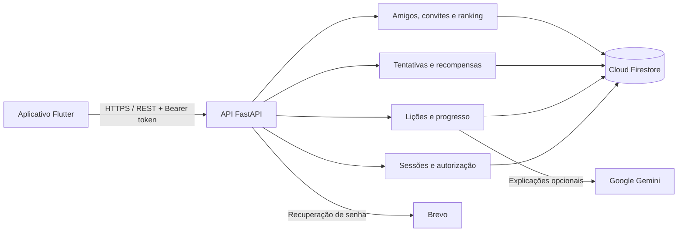

# CodePath

**Aprenda lógica de programação, um desafio de cada vez.**

O CodePath é uma aplicação móvel gamificada projetada para ensinar lógica de programação de forma interativa e divertida. Inspirado em experiências como o Duolingo, transforma o estudo em trilhas de conhecimento, exercícios, recompensas em moedas e competições entre estudantes.

O projeto reúne um aplicativo **Flutter** e uma API **FastAPI**, com persistência no **Cloud Firestore** e explicações de exercícios apoiadas por IA.

> **Status:** preparação técnica para publicação Android. O repositório possui configuração de release, testes e geração de APK/AAB, mas a publicação na Play Store ainda depende da configuração do titular, da implantação da API e da homologação em dispositivos. Consulte o [guia de publicação](docs/play-store/publicacao.md).

## Navegação

- [Demonstração](#demonstração)
- [Capturas de tela](#capturas-de-tela)
- [Funcionalidades](#funcionalidades)
- [Arquitetura](#arquitetura)
- [Tecnologias](#tecnologias)
- [Estrutura do repositório](#estrutura-do-repositório)
- [Configuração e execução](#configuração-e-execução)
- [Testes e qualidade](#testes-e-qualidade)
- [Build Android e publicação](#build-android-e-publicação)
- [Documentação complementar](#documentação-complementar)

## Demonstração

Assista ao app funcionando:

[](https://www.youtube.com/watch?v=UzxwLV0mMh4)

## Capturas de tela

As capturas estáticas das telas ainda não estão versionadas. O vídeo acima apresenta o aplicativo em funcionamento.

Para completar a galeria, capture as telas reais no dispositivo ou emulador e adicione as imagens em `docs/capturas/`. Sugestão de cobertura:

| Tela | O que apresentar |
|---|---|
| Início e acesso | Boas-vindas, login e cadastro |
| Trilhas | Módulos de aprendizagem e progressão entre fases |
| Exercícios | Múltipla escolha, banco de palavras e ordenação de código |
| Competição | Batalha, resultado e desafio semanal |
| Perfil | Progresso, moedas e configurações |

Use contas de demonstração e evite expor e-mails, telefones ou dados pessoais nas imagens.

## Funcionalidades

### Aprendizagem

- **Trilhas por assunto:** variáveis e tipos de dados, condicionais, laços de repetição, funções e perguntas diversas.
- **Exercícios interativos:** múltipla escolha, preenchimento com banco de palavras e ordenação de blocos de código.
- **Progressão por fases:** acompanhamento do avanço e desbloqueio de etapas nas trilhas.
- **Dificuldade configurável:** ajuste do nível de aprendizagem.
- **Feedback de exercícios:** correção das respostas e explicações com IA quando a integração está disponível.

### Gamificação e interação social

- Moedas, pontuações e sequência de uso (*streak*).
- Batalhas com outros jogadores e convites entre amigos.
- Desafio semanal com limite de tentativas.
- Ranking, busca de usuários, pedidos de amizade e notificações dentro do aplicativo.
- Retomada de tentativas de jogo e recuperação do estado após falhas de conexão.

### Conta e privacidade

- Cadastro, login, edição de perfil e recuperação de senha por e-mail.
- Sessões autenticadas com armazenamento seguro do token no aparelho.
- Logout e exclusão de conta e dados, com confirmação de senha.
- Acesso à política de privacidade e ao suporte, conforme configuração do release.

## Arquitetura

A aplicação mantém uma arquitetura de **cliente mobile + API centralizada**. As funcionalidades do servidor são organizadas em módulos dentro de um único backend.



### Responsabilidades

| Camada | Responsabilidade |
|---|---|
| Aplicativo Flutter | Telas, navegação, interação com os exercícios e apresentação do estado com Provider |
| Infraestrutura mobile | Configuração por ambiente, cliente HTTP com timeout e armazenamento seguro da sessão |
| API FastAPI | Contratos HTTP, validação dos dados, autenticação, autorização e regras de negócio |
| Serviço de jogos | Tentativas persistidas, correção de respostas, prazo de jogo e recompensas transacionais |
| Cloud Firestore | Usuários, progresso, sessões, relações sociais, notificações e partidas |
| Integrações externas | Explicações de exercícios com Gemini e envio de recuperação de senha com Brevo |

Nas batalhas e nos desafios, o aplicativo envia as respostas; **a pontuação é calculada pelo servidor**. A finalização registra o resultado e as recompensas em transação, para que um retry não conceda moedas ou pontos novamente.

As credenciais Firebase, Gemini e Brevo pertencem ao ambiente do backend. Elas não devem ser incluídas no aplicativo nem em `--dart-define`.

## Tecnologias

| Área | Tecnologias principais |
|---|---|
| Mobile | Flutter, Dart e Material |
| Estado e comunicação | Provider, `http` e `shared_preferences` |
| Sessão no aparelho | `flutter_secure_storage` |
| Recursos de interface | Google Fonts, `intl`, `url_launcher` e `package_info_plus` |
| Backend | Python, FastAPI, Pydantic e Uvicorn |
| Persistência | Cloud Firestore e Firebase Admin SDK |
| Senhas e sessões | bcrypt e tokens aleatórios com hash armazenado no servidor |
| IA e e-mail | Google Gemini e Brevo |
| Testes | Flutter Test, pytest e HTTPX |
| Automação | GitHub Actions, Gradle e Android SDK/NDK |

### Ambiente de referência

- **Flutter 3.38.5 / Dart 3.10.4:** versões utilizadas na validação e no CI.
- **Python 3.11:** versão recomendada para desenvolvimento e CI do backend.
- **JDK 17:** versão utilizada no CI Android; a validação local também utilizou Java 21.
- **Android SDK Platform 36** e **NDK 28.2.13676358**.

O foco atual de preparação para distribuição é Android. A existência de pastas de outras plataformas Flutter não representa homologação dessas plataformas.

## Estrutura do repositório

```text
Projeto_CodePath/
├── Backend/
│   ├── main.py                    # Aplicação FastAPI e registro das rotas
│   ├── firebase_config.py         # Inicialização do Firestore
│   ├── security.py                # Sessões, autorização e limites de tentativas
│   ├── games.py                   # Tentativas, correção e finalização dos jogos
│   ├── pages/                     # Endpoints por funcionalidade
│   ├── scripts/                   # Scripts de carga e integrações auxiliares
│   ├── test/                      # Testes de contratos existentes
│   ├── tests/                     # Testes de segurança, conta e jogos
│   ├── firestore.indexes.json     # Referência de índices e TTL
│   ├── requirements-dev.txt       # Dependências de desenvolvimento e testes
│   └── requirements-release.txt   # Dependências do backend para release
├── Frontend/code_path_flutter/
│   ├── lib/
│   │   ├── core/                  # Configuração, rede e sessão
│   │   ├── pages/                 # Telas do aplicativo
│   │   └── providers/             # Estado compartilhado do usuário
│   ├── assets/                    # Identidade visual, personagens e fundos
│   ├── android/                   # Configuração e assinatura Android
│   ├── config/                    # Exemplo de configuração pública do release
│   └── test/                      # Testes Flutter
├── .github/workflows/mobile.yml   # Pipeline de validação e build
├── docs/play-store/               # Publicação, privacidade e evidências
├── tools/                        # Verificação do alinhamento de bibliotecas nativas
└── guia-do-projeto.md             # Guia de execução e preparação Android
```

## Configuração e execução

### 1. Preparar o backend

Abra um terminal na pasta `Backend` e crie um ambiente virtual:

```sh
python -m venv .venv
```

Ative o ambiente conforme seu sistema:

**Windows / PowerShell**

```powershell
.\.venv\Scripts\Activate.ps1
```

**Linux / macOS**

```sh
source .venv/bin/activate
```

Instale as dependências:

```sh
python -m pip install -r requirements-dev.txt
```

Copie `Backend/.env.example` para `Backend/.env` e preencha os valores necessários. Configure também o acesso ao Firestore por uma das opções:

- Variável de ambiente `GOOGLE_APPLICATION_CREDENTIALS`, definida no processo antes de iniciar a API e apontando para a chave de serviço.
- Credenciais padrão do ambiente de hospedagem (*Application Default Credentials*).
- Arquivo local `Backend/firebase-service-account.json`, ignorado pelo Git.

| Configuração | Finalidade |
|---|---|
| Credencial Firestore | Necessária para funcionalidades que consultam ou alteram dados |
| `GEMINI_API_KEY` | Habilita as explicações geradas por IA; a API pode iniciar sem ela |
| `BREVO_API_KEY` | Habilita o envio de recuperação de senha |
| `MAIL_FROM` | Remetente configurado e validado no provedor de e-mail |
| `MAIL_FROM_NAME` | Nome exibido como remetente dos e-mails |

Inicie a API, ainda na pasta `Backend`:

```sh
python -m uvicorn main:app --reload --host 0.0.0.0 --port 8000
```

- Status da API: `http://127.0.0.1:8000/`.
- Documentação interativa: `http://127.0.0.1:8000/docs`.

A rota de status confirma que a aplicação iniciou; as funcionalidades persistentes exigem Firestore configurado. Para release, utilize `requirements-release.txt`. O `requirements.txt` original é legado e contém versões diferentes.

> Os scripts de carga em `Backend/scripts/` incluem operações destrutivas. Não os execute como parte da instalação ou dos testes, especialmente contra um banco de produção.

### 2. Preparar o aplicativo

Em outro terminal, abra `Frontend/code_path_flutter`:

```sh
flutter pub get --enforce-lockfile
flutter devices
flutter run --dart-define=API_BASE_URL=https://SEU-BACKEND
```

Substitua `https://SEU-BACKEND` por uma origem HTTPS acessível ao dispositivo, sem caminho, query ou fragmento. Para consumir a API local pelo aplicativo, disponibilize um endpoint HTTPS de desenvolvimento; `localhost` no telefone não aponta para o computador.

**O aplicativo aceita apenas HTTPS.** O endereço padrão é o servidor Render usado pelo projeto, mas ele precisa estar executando o backend atualizado: o login exige `access_token` e os jogos usam o contrato de tentativas. Não combine o aplicativo novo com a API antiga.

No Windows, habilite o Modo de Desenvolvedor caso o Flutter informe que os plugins precisam de suporte a symlinks.

## Testes e qualidade

**Backend — executar em `Backend`:**

```sh
python -m pytest -q
```

Os testes substituem o acesso ao Firestore e não precisam de credenciais de produção.

**Mobile — executar em `Frontend/code_path_flutter`:**

```sh
flutter analyze --no-fatal-infos
flutter test
```

A análise mantém erros e warnings como bloqueadores; avisos informativos legados continuam visíveis. A cobertura inclui autenticação, autorização, exclusão de conta, cálculo de pontuação, idempotência de recompensas e cenários de retomada da interface.

O [workflow Mobile Android](.github/workflows/mobile.yml) executa as verificações e gera um APK de teste em push/PR que altere o aplicativo, o backend ou o próprio workflow. Consulte as [evidências de validação local](docs/play-store/validacao.md) e os limites dessa validação antes de preparar uma publicação.

## Build Android e publicação

Para gerar um **APK de desenvolvimento**, execute na pasta Flutter:

```sh
flutter build apk --debug
```

Saída:

```text
Frontend/code_path_flutter/build/app/outputs/flutter-apk/app-debug.apk
```

Para gerar um **AAB de produção**, primeiro configure:

1. Identificador Android definitivo (`ANDROID_APPLICATION_ID`).
2. Keystore e credenciais da chave de upload, usando `android/key.properties.example` como referência.
3. `config/release.json`, a partir de `config/release.example.json`, com API HTTPS, política de privacidade, página externa de exclusão e e-mail de suporte reais.
4. Backend atualizado, índices do Firestore e ambiente de homologação.

Com esses itens configurados, execute na pasta Flutter:

```sh
flutter build appbundle --release --build-number=1 --dart-define-from-file=config/release.json
```

O número `1` é um exemplo: use um `versionCode` inédito e maior que todos os já enviados ao Play Console. O Gradle bloqueia release sem a configuração exigida e não utiliza a chave de debug como fallback.

O CI também permite gerar o AAB manualmente, após configurar as variables e os secrets descritos no [guia de publicação](docs/play-store/publicacao.md). O workflow gera o artefato, mas não publica automaticamente na loja.

**Não versione** `.env`, credenciais Firebase, `key.properties`, keystore, senhas ou arquivos de build. A homologação em dispositivos, as informações de privacidade, as capturas reais e os requisitos da conta Play Console fazem parte da preparação final.

## Documentação complementar

| Documento | Conteúdo |
|---|---|
| [Guia do projeto](guia-do-projeto.md) | Execução, configuração e preparação Android |
| [Publicação na Play Store](docs/play-store/publicacao.md) | Assinatura, AAB, CI e roteiro de homologação |
| [Evidências de validação](docs/play-store/validacao.md) | Verificações executadas e pontos ainda não homologados |
| [Rascunho de privacidade](docs/play-store/privacidade-rascunho.md) | Base para o responsável revisar e preparar a política pública |
